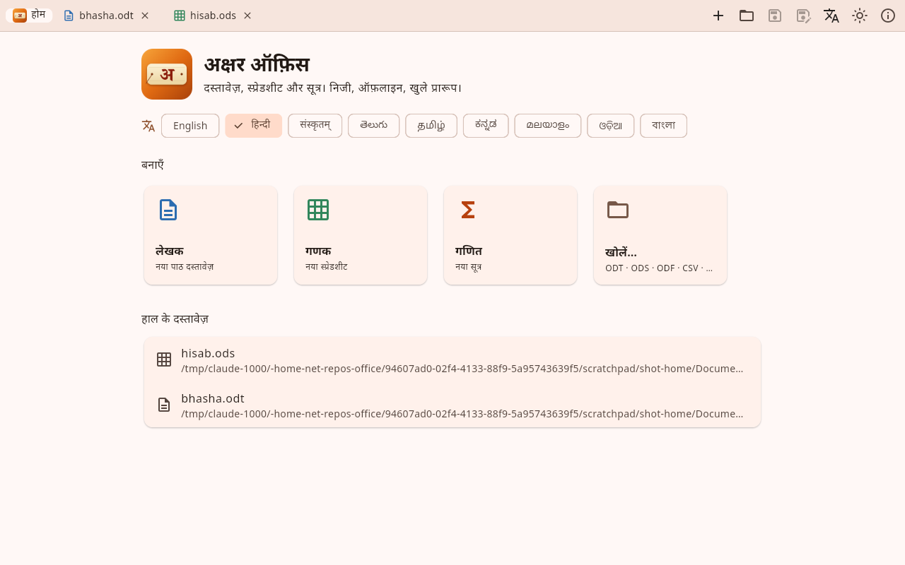
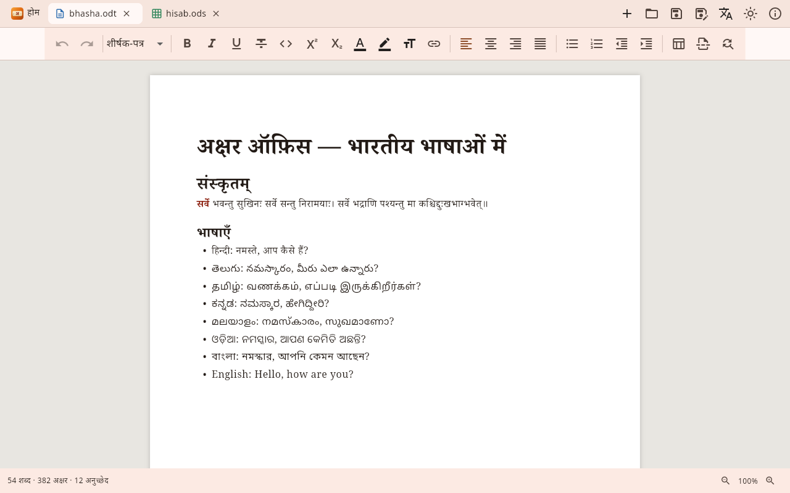
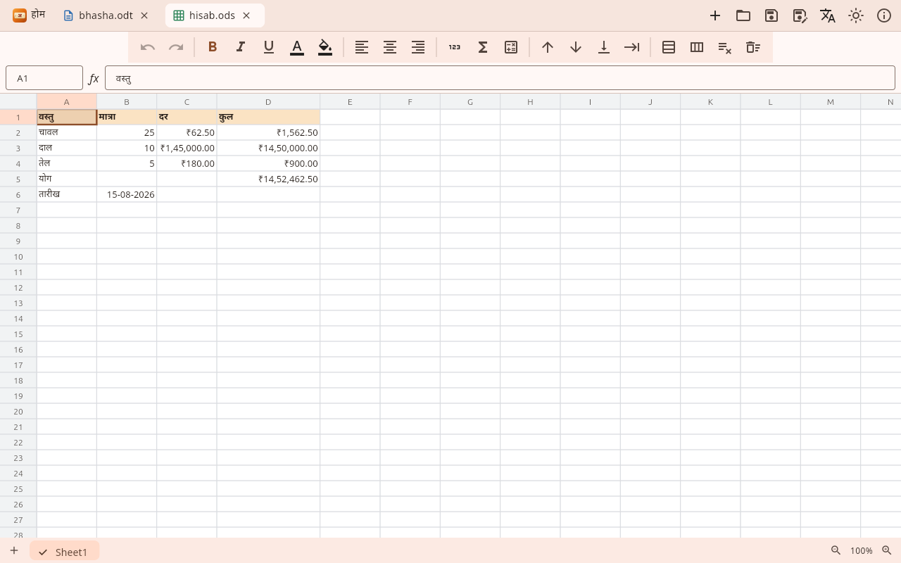
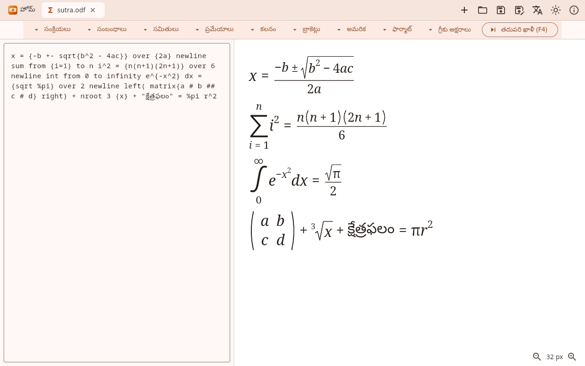

<p align="center"></p>

# Akshara Office · अक्षर ऑफ़िस

**Akshara** (अक्षर, "letter, syllable" and also "imperishable") is a secure,
offline, cross-platform office suite for **English and Indian languages**.
It reads and writes the OpenDocument formats used by Apache OpenOffice and
LibreOffice. It starts with three applications:

| App | Does | Native format | Also opens / saves |
|---|---|---|---|
| **Writer** · लेखक | Word processing | `.odt` | `.txt` · exports `.html`, `.md` |
| **Calc** · गणक | Spreadsheets, 131 functions | `.ods` | `.csv`, `.tsv` |
| **Math** · गणित | Formula editor (StarMath language) | `.odf` | `.mml` (MathML) |

The core is written in **Rust** and the user interface in **Flutter**. It
builds for **Windows, Linux, macOS, Android and iOS**, and needs **no network
access and no administrator rights**.

<p align="center">




</p>

## Highlights

- **Nine interface languages:** English, हिन्दी (Hindi), संस्कृतम् (Sanskrit),
  తెలుగు (Telugu), தமிழ் (Tamil), ಕನ್ನಡ (Kannada), മലയാളം (Malayalam),
  ଓଡ଼ିଆ (Odia) and বাংলা (Bengali). You can switch with one tap on the Home
  screen; the app follows the system language by default.
- **Built-in Indic transliteration, powered by
  [teltools](https://github.com/revurpk/teltools):** type `namastE` and get
  నమస్తే, नमस्ते, நமஸ்தே, ನಮಸ್ತೇ, നമസ്തേ, ନମସ୍ତେ or নমস্তে as you type, in
  Writer, Calc and Math. No system keyboard setup is needed. You can also
  convert existing text between scripts and to or from IAST
  (`satyamEva jayatE` → सत्यमेव जयते → *satyameva jayate*).
- **Bundled Google Noto fonts** (SIL Open Font License) for Latin,
  Devanagari, Bengali, Odia, Telugu, Tamil, Kannada, Malayalam and maths. Text
  looks the same on every device, even without system fonts.
- **Made for Indian users:** lakh/crore digit grouping (`12,34,567.00`),
  rupee amounts (`₹2,50,000` is recognised as you type), DD-MM-YYYY dates, and
  Indic text inside formulas.
- **Secure by design:** hardened parsers for untrusted files, no macros, no
  scripts, no external links followed, no telemetry, no network code at all.
  See [docs/security.md](docs/security.md).
- **Open formats:** ODF 1.2 output that OpenOffice and LibreOffice can open.
  The output is deterministic, and saves are atomic.
- **Tested:** 182 Rust tests (unit, behavioural and property-based fuzzing of
  every parser) plus 16 for the vendored teltools (byte-identical with
  upstream's own test vectors), and 26 Flutter tests that drive the real Rust
  library.

## Quick start (desktop)

```bash
./run.sh                 # builds the Rust core and the app, then starts it
./run.sh letter.odt      # ...and opens a document
```

Prerequisites: [Rust](https://rustup.rs) and the
[Flutter SDK](https://docs.flutter.dev/get-started/install), both
installable without admin rights, plus the usual desktop toolchain for your
OS. Details for every platform are in [docs/building.md](docs/building.md).

## Installing

Every installer works **without sudo or administrator rights**:

| Platform | Package | Install |
|---|---|---|
| Linux | `akshara-<ver>-linux-x64.tar.gz` | extract, run `./install.sh` (installs to `~/.local`) |
| Windows | `akshara-<ver>-windows-x64-setup.exe` | per-user setup into `%LOCALAPPDATA%\Programs` (no UAC prompt), or the portable zip |
| macOS | `akshara-<ver>-macos.dmg` | drag to `~/Applications`, or double-click *Install for me* |
| Android | `app-<abi>-release.apk` | sideload; no root needed |
| iOS | signed `.ipa` | via TestFlight, the App Store or your own signing |

See [docs/installing.md](docs/installing.md). Build the packages with the
scripts in [`packaging/`](packaging/).

## Repository layout

```
crates/odf      Hardened ZIP + XML (OpenDocument packages), limits, metadata
crates/writer   Text document model, editing + undo, ODT / HTML / Markdown
crates/calc     Spreadsheet engine: formulas, 131 functions, recalculation, ODS / CSV
crates/math     StarMath parser, MathML import/export, ODF formula files
crates/indic    Indic transliteration for 7 scripts, built on teltools
crates/ffi      C ABI (3 functions, JSON protocol) used by Flutter via dart:ffi
third_party/teltools  teltools by Pradyumna Revur (Apache-2.0), vendored
tools/icongen   Renders branding/*.svg into every platform's icons
app/            Flutter application (lib/, platform projects, fonts, tests)
packaging/      Per-user installers for Linux, Windows, macOS, Android, iOS
scripts/        Native build helper
docs/           Architecture, security, protocol, building, user guide
```

## Testing

```bash
cargo test --workspace                       # Rust: 182 tests incl. property tests
(cd third_party/teltools && cargo test)      # vendored teltools vs upstream vectors
cargo clippy --workspace --all-targets       # lint (clean)
cargo build -p akshara-ffi && (cd app && flutter test)   # Flutter: 26 tests, real core
(cd app && flutter analyze)                  # Dart analyzer (clean)
```

## Documentation

- [User guide](docs/user-guide.md): Writer, Calc, Math, shortcuts, typing Indic text
- [Architecture](docs/architecture.md): how the pieces fit together
- [Security model](docs/security.md): threat model and defences
- [FFI protocol](docs/ffi-protocol.md): the JSON API between Flutter and Rust
- [Building](docs/building.md) and [installing](docs/installing.md)
- [Localization](docs/localization.md): adding or correcting translations

## Status and scope

Akshara is a new, independent implementation, **not a port of the
OpenOffice C++ code base**. It covers the core of each application: rich text
with lists and tables; multi-sheet workbooks with styles, number formats and
an incremental formula engine; and the full StarMath formula language.
Charts, images, drawing objects, tracked changes, comments, mail merge,
macros and printing are not implemented yet. Content the model does not cover
is dropped on save, and the [user guide](docs/user-guide.md#limitations)
lists what that means.

The translations were drafted with machine assistance and reviewed for
consistency. Corrections from native speakers are very welcome (see
[docs/localization.md](docs/localization.md)).

## License

Apache License 2.0 (see [LICENSE](LICENSE) and [NOTICE](NOTICE)). The bundled
Noto fonts are under the SIL Open Font License 1.1. Transliteration uses
[teltools](https://github.com/revurpk/teltools) by Pradyumna Revur (Apache
License 2.0), vendored with documented changes in `third_party/teltools`. "Apache" and "OpenOffice"
are trademarks of the Apache Software Foundation; this project is not
affiliated with it.
